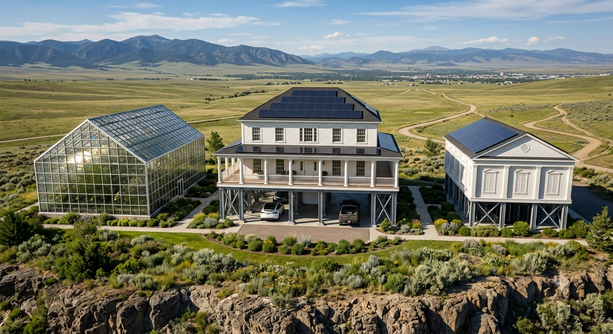



# Simbiosis Homes / CyberNest Montana

Modular AI compute habitat for cold climates.

## Status
Concept phase. Documentation only. No code.

## Idea in one line
A residential building that heats itself from the waste heat of an embedded AI compute cluster, with a modular swappable cooling spine, a tropical greenhouse, and full energy autonomy.

## The problem
California attracted a generation of top engineers, designers, and AI specialists. It is now overcrowded, expensive, and politically strained. Meanwhile, cold-climate regions have cheap land, natural cooling, and no structural capacity to host the next wave of AI-driven work.

## The solution
A home first, compute second. Three configurations: single-family, duplex, or four-unit building. Heat from processors warms the floors. Condensate waters the greenhouse. Solar and a small wind turbine power the building. Surplus compute is sold externally while residents sleep.

## Why Montana
Seismic Category D, wind up to 115 mph, and deep winter. The climate is not a bug; it is the engine. Cold air cools the servers. Server heat warms the home. The worse the weather, the more valuable the system.

## Repository structure

### Concept
- [Concept Overview](docs/concept/00-overview.md) — problem, idea, why cold climates, what comes next
- [Governance & Compute Allocation](docs/concept/01-governance.md) — quotas, greenhouse rotation, sale of units, disputes

### Engineering nodes
- [Node 01 — Site & Foundation](docs/nodes/01-site-foundation.md) — geotech, seismic, permitting pathway
- [Node 02 — Service Channel & Condensate](docs/nodes/02-service-channel.md) — shallow channel, insulation, drainage, duplication
- [Node 03 — Compute Spine](docs/nodes/03-compute-spine.md) — racks, flexible loops, hot-swap, ventilation, fire safety
- [Node 04 — Heating & Cooling Loop](docs/nodes/04-heating-cooling-loop.md) — heat exchangers, four greenhouse zones, backup boiler, controls
- [Node 05 — Greenhouse](docs/nodes/05-greenhouse.md) — structure, climate zones, ventilation, condensate
- [Node 06 — Water System](docs/nodes/06-water-system.md) — two tanks, gravity distribution, treatment, freeze protection
- [Node 07 — Energy](docs/nodes/07-energy.md) — solar, battery, generator, technical building zoning, propane, diesel, boiler
- [Node 08 — Structure & Seismic](docs/nodes/08-structure-seismic.md) — columns, open parking, EV charging, sound isolation, flexible entries
- [Node 09 — Network & Connectivity](docs/nodes/09-network-connectivity.md) — dual external channels, fiber to units, fabric-agnostic cabling

### Legal
- [Legal & Permitting](docs/legal/01-zoning-permits.md) — LUP, state building permit exemption, seismic category, water rights, WUI

### Finance
- [Cost, ROI, and Beverly Hills Comparison](docs/finance/01-cost-roi.md) — capital cost, operating economics, variants

## Core principles

- **Productive asset, not consumption asset.** The building produces heat, food, compute, and revenue.
- **Heat is a resource, not a waste product.** Every watt spent on computation becomes a watt of indoor heating.
- **Modular and swappable.** Compute modules can be replaced without stopping the building.
- **Manual override everywhere.** Every critical function has a mechanical or analog fallback.
- **Fabric-agnostic infrastructure.** The building does not lock the owner into one compute vendor.
- **Flexibility clause in every node.** Every parameter can change to reduce cost, but the base requirements are preserved.

## Language
GitHub-facing documents: English.
Working drafts: bilingual allowed.

## License
Concept documentation. No license applied yet. Contact the repository owner before reuse.

## License

This concept documentation is licensed under **CC BY-NC-SA 4.0**. Attribution required. Commercial use requires permission from the author. See [LICENSE](LICENSE) for full text.

**Authorship note:** Concept developed by dwfirst in collaboration with an AI assistant (DeepSeek). Public commit history in this repository serves as a dated record of authorship.

## License

This work is licensed under **CC BY-NC-SA 4.0**. Attribution required. Commercial use requires permission from the author. See [LICENSE](LICENSE) for full text.

**Authorship note:** Concept developed by Dwane Kimbrough in collaboration with an AI assistant (DeepSeek). Public commit history in this repository serves as a dated record of authorship.

## Development History

The concept visualization was created by July 2026 (see `assets/visualization-exterior.png`, file metadata dated 08 July 2026). Concept development continued through mid-2026 in collaboration with Gemini (Google). Engineering documentation, structuring, and repository setup were completed in November 2026 in collaboration with DeepSeek.

The repository was first published in November 2026. Commit history and file metadata provide a dated record of the work. This is an international collaboration: an American AI for concept exploration, a Chinese AI for engineering documentation, and a human visionary who directed both.
